# 🚀 Developer Testing Assistant & Browser Extension Ecosystem

  

  
  
  
  
  
  

---

## 📌 Executive Summary & Category Scope

> **A curated showcase of premier developer testing assistants, browser extensions, and QA authoring tools.**  
> *Covering in-browser record-and-playback, API request interception & mocking, exploratory test data injection, and headless automation generation.*

This repository tracks top-tier **SaaS platforms** and **open-source GitHub projects** that live directly inside Chromium, Firefox, and WebKit browsers. By enabling software engineers, SDETs, and QA specialists to record browser user journeys, mock REST/GraphQL APIs on the fly, inject boundary values, and synchronize test runs to distributed cloud grids, these extensions bridge the gap between IDE code editors, terminal CLIs, and live browser runtimes.

---

## 📑 Table of Contents

- [📊 Sector Overview & Market Dynamics](#-sector-overview--market-dynamics)
- [🏢 SaaS/Hosted Platforms](#-saashosted-platforms)
- [💻 Open-Source GitHub Projects](#-open-source-github-projects)
  - [Top Open-Source Testing & Recorder Extensions](#top-open-source-testing--recorder-extensions)
  - [Architectural & Framework Recommendations](#architectural--framework-recommendations)
- [🤝 How to Contribute](#-how-to-contribute)
- [💖 Support & Sponsorship](#-support--sponsorship)
- [📈 Star History](#-star-history)
- [⚠️ Disclaimer](#️-disclaimer)

---

## 📊 Sector Overview & Market Dynamics

The global software test automation market is valued at approximately **$28 billion to $35 billion** (projected to exceed $85 billion+ over the coming decade at a **~14% CAGR**). 

The sector exhibits **moderate fragmentation**: enterprise software testing remains anchored by major consolidation platforms (such as Tricentis and BrowserStack), yet open-source test runners (Playwright, Puppeteer, Selenium) alongside continuous innovation in lightweight browser extensions, AI self-healing locators, and DevTools recorders ensure healthy market diversity rather than a single winner-take-all monopoly.

---

## 🏢 SaaS/Hosted Platforms

The following commercial testing platforms offer specialized browser extensions or companion plugins to streamline test authoring, visual validation, and test management.

| Product | Company Scale (Valuation / Revenue) | Description | Starting Pricing | Free Tier / Trial Limits |
|:---|:---|:---|:---|:---|
| **[Testim Editor (Tricentis)](https://chromewebstore.google.com/detail/testim-editor/pebeiooilphfmbohdbhbomomkkoghoia)** | **$4.5B valuation** (~$500M ARR; parent Tricentis backed by GTCR/Insight) | Chrome extension for recording and playing back functional UI tests in Testim with AI-based Smart Locators. Syncs to cloud for CI-driven cross-browser execution. | **$450/month** (Starter / Essentials entry tier, annual commitment) | **Free forever Community plan** (up to 1,000 web test runs/month locally & basic cloud execution); also offers a 14-day free trial |
| **[BrowserStack Test Companion](https://www.browserstack.com/docs/test-companion/web-testing)** | **$4.0B valuation** (~$225M ARR; funded by BOND, Insight, Accel) | IDE & testing extension that brings AI-powered testing into workflows. Generates test cases from PRDs/diffs, authoring automation scripts and diagnosing failures. | **$29/month** (Live desktop individual plan; Automate parallel runs start at $99/mo) | **No permanent free tier**; Free trial provides 30 minutes of manual Live testing and 100 minutes of automated testing |
| **[mabl (Browser Plugin)](https://www.getapp.nl/software/122447/mabl)** | **~$360M valuation** (~$18M–$25M ARR; $76M total funding led by Vista Equity) | Scriptless browser extension recorder with auto-healing locators, visual regression monitoring, and API/performance test generation. | **$450/month** (Starter tier entry baseline, credit-based annual contract) | **No permanent free tier**; 14-day free trial with full platform access (local CLI/trainer runs are free) |
| **[Katalon Studio / Recorder](https://chromewebstore.google.com/detail/katalon-recorder-selenium/ljdobmomdgdljniojadhoplhkpialdid)** | **~$150M–$200M est. valuation** (~$40M–$50M ARR; $30M Series A via Elephant VC) | Automated test authoring tool suite and companion browser recorder for generating, debugging, and exporting Selenium/Appium scripts. *(Note: Katalon Recorder extension itself is maintenance-mode).* | **$150/user/month** (Katalon Studio Enterprise, billed annually) | **Free forever plan** (Katalon Studio Free desktop edition for local test authoring and execution; extension is 100% free; 30-day enterprise trial available) |
| **[Ghost Inspector (Web Test Recorder)](https://chromewebstore.google.com/detail/ghost-inspector-web-test/aicdiabnghjnejfempeinmnphllefehc)** | **Bootstrapped / Acquired** (Profitable SMB SaaS acquired by SureSwift Capital, ~$3M–$7M est. ARR) | Browser extension for recording end-to-end automated website user tests and visual assertions directly in Chrome/Firefox. Syncs to cloud for scheduled runs. | **$109/month** (Starter plan billed annually, or $125/month billed monthly) | **No permanent free tier**; 14-day free trial (no credit card required) with full Scale-tier feature access and up to 10,000 test runs |

---

## 💻 Open-Source GitHub Projects

Explore the open-source ecosystem of browser extensions engineered for QA automation, traffic interception, test playback, and exploratory inspection. Sorted in descending order by GitHub stargazers.

### Top Open-Source Testing & Recorder Extensions

| Project | GitHub Stars | Description | Primary Capabilities |
|:---|:---:|:---|:---|
| **[Checkly Headless Recorder](https://github.com/checkly/headless-recorder)** |  | **Open-source Chrome extension that records user interactions and converts them into Playwright and Puppeteer scripts.** Clean test generator with support for data-testid attributes, pauses, and element assertions. | ⏺ Playwright / Puppeteer script generation, selector tuning, headless browser testing |
| **[Requestly](https://github.com/requestly/requestly)** |  | **The preeminent open-source browser extension for HTTP interception and API mocking.** Trusted by 300,000+ developers. Modifies network requests without setting up an external proxy daemon. Now part of BrowserStack. | ⚡ API client, REST & GraphQL mocking, HTTP header manipulation, URL redirects, user session replay |
| **[Selenium IDE](https://github.com/SeleniumHQ/selenium-ide)** |  | **The reference open-source record-and-playback extension for Selenium test suites.** Runs in Chrome and Firefox with built-in control flow logic, smart locators, test case reusability, and runner plugins. | 🔄 Record-and-playback, Selenium suite export, locator fallback strategies |
| **[Puppeteer Replay](https://github.com/puppeteer/replay)** |  | **Official Google Chrome DevTools Recorder extension and replay library.** Enables developers to replay, customize, and convert DevTools recorded user flows into automated test suites. | 🎬 Chrome DevTools Recorder integration, replay CLI, custom extension runners |
| **[Ajax Interceptor](https://github.com/YGYOOO/ajax-interceptor)** |  | **A lightweight Chrome extension to intercept and mock `XMLHttpRequest` and `fetch` requests.** Allows web developers to inject mock responses into frontend code on the fly without backend deployment. | 💉 In-browser Ajax/Fetch mocking, status code override, response schema simulation |
| **[Playwright CRX](https://github.com/ruifigueira/playwright-crx)** |  | **Run Playwright directly inside Chrome Extensions via the Chrome Debugger API.** Enables recording, replaying, and executing Playwright automation entirely within the user's browser runtime. | 🎭 Native Playwright codegen in browser, Chrome Debugger integration, client-side script execution |
| **[DeploySentinel Recorder](https://github.com/DeploySentinel/Recorder)** |  | **Open-source browser extension that captures user actions and produces clean Cypress, Playwright, and Puppeteer code.** Emphasizes resilient CSS/XPath selectors and actionable comments. | 📝 Multi-framework code output (Cypress, Playwright, Puppeteer), resilient DOM selectors |
| **[Katalon Recorder (OSS)](https://github.com/katalon-studio/katalon-recorder)** |  | **Open-source codebase for the Katalon Recorder extension.** Popular historical record-and-playback tool for browser scripting. *(Note: officially in maintenance mode; serves as an architectural blueprint).* | 💾 Historical record/export reference, local HTML reporting, Selenium test conversion |
| **[Bug Magnet](https://github.com/gojko/bugmagnet)** |  | **Exploratory testing assistant browser extension.** Provides right-click context menu options to inject common problematic boundary values, edge cases, invalid formats, and injection strings into form fields. | 🧲 Passive exploratory data injection, zero-overhead input fuzzing, zero third-party dependencies |

### Architectural & Framework Recommendations

- ⚡ **For Network Mocking & Request Interception**: Choose **Requestly** for comprehensive HTTP/GraphQL manipulation and session capture, or **Ajax Interceptor** for zero-setup lightweight mock payloads.
- 🎬 **For Modern Test Generation**: Pair **Checkly Headless Recorder** or **Playwright CRX** for generating modern Playwright/Puppeteer automation scripts directly from browser clicks.
- 🧲 **For Exploratory QA & Edge Cases**: Use **Bug Magnet** to quickly stress-test input validations, boundary limits, and sanitization routines without leaving the tab.
- 🔄 **For Legacy or Suite Migration**: Use **Selenium IDE** when maintaining established enterprise Selenium test suites.

---

## 🤝 How to Contribute

We love community contributions! To add a new testing extension or update details:

1. 🍴 **Fork** this repository.
2. 🌿 **Create a branch** for your feature (`git checkout -b feature/add-new-tool`).
3. ✏️ **Edit `README.md`** following the established table formats (ensure accurate star badges, link to official resources, and verify pricing details).
4. 📬 **Submit a Pull Request** with a brief summary of the project's features and utility.

Please make sure added tools have active maintenance, factual descriptions, and clear links.

---

## 💖 Support & Sponsorship

If this curated repository helped streamline your testing workflow, save engineering hours, or discover your favorite QA extension, please consider supporting the project!

- ⭐ **Star this repository** to help fellow developers discover it.
- 🍴 **Fork and share** with your QA team, dev leads, and engineering circles.
- ☕ **Buy me a coffee**: Support ongoing open-source curation and tool evaluation through the [GitHub Sponsors Dashboard](https://github.com/sponsors/ishandutta2007).

Thank you to all sponsors, contributors, and testers advocating for better developer tooling! 🚀

---

## 📈 Star History

---

## ⚠️ Disclaimer

- This is a **community-curated directory** provided for educational and informational purposes. Inclusion does not imply formal endorsement.
- **Security & Privacy Caution**: Browser extensions capable of intercepting HTTP traffic or recording DOM sessions interact with sensitive runtime memory. Always inspect extension permissions, avoid recording credentials or PII, and only install software from trusted sources.
- **Maintenance & Commercial Licensing**: Tools such as Katalon Recorder OSS are currently in maintenance mode. Commercial solutions (such as Testim and Ghost Inspector) require subscription accounts to utilize their cloud-backed testing grids. Verify current licensing and organizational compliance before deploying into production pipelines.

---

  <b>Built with ❤️ for SDETs, QA Engineers, and Frontend Developers worldwide.</b>

